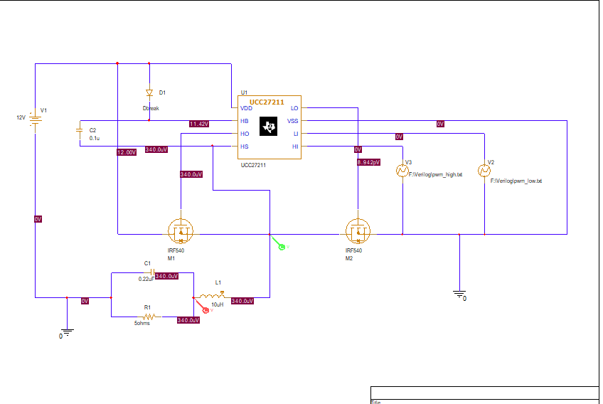

# Open-Loop AMS Synchronous Buck Converter

This project is about designing and simulating an open-loop synchronous buck converter by combining digital control logic written in Verilog HDL with an analog power stage in Cadence PSpice.
The main idea was to generate PWM signals using Verilog, implement dead-time control to avoid simultaneous switching of the two MOSFETs, and integrate the digital control with the analog converter circuit through co-simulation.
The project helped me explore the interaction between digital control logic and analog power electronics.

## Project Overview

The design is divided into three main sections:

1. **Digital Control:** Generates PWM signals and controls the switching sequence using Verilog HDL.
2. **Gate Drive Circuit:** Uses the UCC27211 gate driver to drive the high-side and low-side MOSFETs.
3. **Analog Power Stage:** A synchronous buck converter circuit simulated in PSpice.

## Project Files

### 1. Verilog HDL – Digital Control

| File | Description |
|---|---|
| [pwm_gen.v](pwm_gen.v) | Generates PWM signals based on the input duty cycle. |
| [deadtime.v](deadtime.v) | Implements an FSM-based dead-time controller to generate non-overlapping high-side and low-side PWM signals. |
| [top_gatedriver.v](top_gatedriver.v) | Top-level module integrating PWM generation, dead-time control, enable logic, and fault handling. |

### 2. Testbenches & Verification

| File | Description |
|---|---|
| [pwm_tb.v](pwm_tb.v) | Testbench for verifying PWM generation. |
| [gatedriver_tb.v](gatedriver_tb.v) | Testbench for verifying the complete gate driver control logic, including duty-cycle changes and fault inputs. |

The simulations generate waveform data that can be analysed using GTKWave.

### 3. PSpice – Analog Power Stage

| File | Description |
|---|---|
| [BUCK_CONVERTOR.DSN](BUCK_CONVERTOR.DSN) | PSpice schematic of the synchronous buck converter circuit. |
| [Buck_convertor.opj](Buck_convertor.opj) | PSpice project file. |
| [BUCK_CONVERTOR.png](BUCK_CONVERTOR.png) | Image of the buck converter circuit diagram. |
| [Buck Converter.pdf](Buck%20Converter.pdf) | Project documentation containing the block diagram, Verilog implementation, simulation waveforms, and circuit results. |

## Circuit Components

| Component | Specification |
|---|---|
| Gate Driver IC | Texas Instruments UCC27211 |
| Power MOSFETs | 2 × IRF540 N-Channel MOSFETs |
| Input Supply | 12V |
| Bootstrap Capacitor | 0.1µF |
| Inductor | 10µH |
| Output Capacitor | 0.22µF |
| Load Resistance | 5Ω |
| Control Method | Verilog-based PWM with FSM dead-time control |

## Circuit Diagram



## Simulation & Results

The digital control logic was first verified using Icarus Verilog, and the generated waveforms were analysed using GTKWave. The digital switching signals were then integrated with the analog power stage in Cadence PSpice.

Some key observations from the simulation:

- The PWM duty cycle changes from **20% to 70% at 20µs**.
- The high-side and low-side PWM signals remain non-overlapping due to the dead-time controller.
- The dead-time logic prevents simultaneous activation of both switching signals, avoiding shoot-through in the simulated switching sequence.
- The output voltage transitions from approximately **2.4V to 8.4V** following the duty-cycle change.

## Tools & Technologies Used

- **Verilog HDL:** PWM generation and digital control logic.
- **Cadence PSpice:** Analog power-stage design and transient analysis.
- **Icarus Verilog:** RTL simulation and verification.
- **GTKWave:** Simulation waveform analysis.
- **Visual Studio Code:** Verilog code development.

## Running the Verilog Simulation

Make sure Icarus Verilog and GTKWave are installed.

Clone the repository:

```bash
git clone https://github.com/AreebJamal/Open-Loop-AMS-Buck-Converter-.git
```

Navigate to the project directory:

```bash
cd Open-Loop-AMS-Buck-Converter-
```

Compile the Verilog modules with the gate-driver testbench:

```bash
iverilog -o output.sim gatedriver_tb.v top_gatedriver.v pwm_gen.v deadtime.v
```

Run the simulation:

```bash
vvp output.sim
```

View the generated waveform:

```bash
gtkwave dump.vcd
```

To simulate the analog power stage, open the `Buck_convertor.opj` project in Cadence PSpice.

## About

This project was a practical exercise in combining digital design with power electronics. It helped me understand PWM generation, finite state machine-based dead-time control, gate-driver interfacing, and the importance of verifying digital control signals before integrating them with an analog power stage.

---

**Author:** Areeb Jamal

**GitHub:** [@AreebJamal](https://github.com/AreebJamal)
